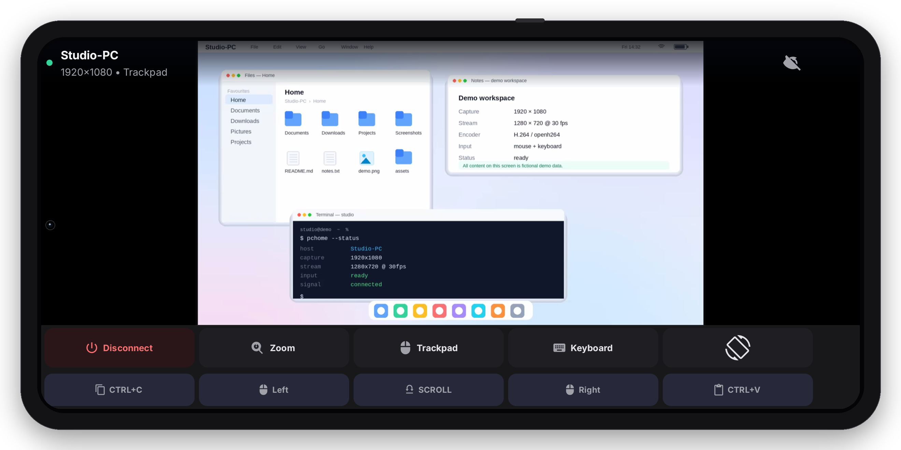
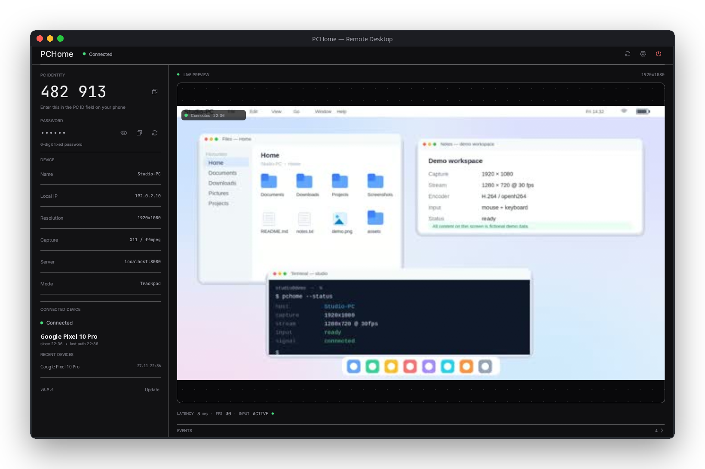

<h1 align="center">PCHome</h1>

<p align="center">Stream a Linux desktop to Android over WebRTC and control the mouse and keyboard from anywhere.</p>

## Screenshots

<p align="center">
  
</p>

<p align="center">
  
</p>

## Features

- Direct WebRTC screen streaming from Linux to Android; the signal server only handles the handshake
- H.264 capture through PipeWire, KWin or X11 with hardware and software encoding fallback
- Permanent 6-digit PC ID and 6-digit password, with input injected through `/dev/uinput`
- Trackpad and direct-touch modes, on-screen keyboard, smooth scrolling, zoom and screen rotation
- Recent connection cards with thumbnails, saved passwords and one-tap reconnect
- Turkish and English interface selected automatically from the device language
- Self-hosted Rust signal server with Docker support and in-app updates from GitHub Releases
- Full-screen mode with side mouse buttons and keyboard-safe touch handling

## Installation

Build and run from source:

```bash
git clone https://github.com/colgecen/PCHome.git
cd PCHome
./pchome --install
```

`--install` is a one-time step that lets you type `pchome` (no `./`) to open the build menu:

```bash
pchome
```

Prebuilt binaries are available on the [Releases](https://github.com/colgecen/PCHome/releases) page.

## Usage

Run the build menu from source:

```bash
./pchome
```

Choose the desktop, Android or signal component and the output format; finished assets are written to `dist/`. Start the desktop app, then enter the signal server URL, PC ID and password shown on the desktop in the Android app. Configuration lives in `~/.config/PCHome/identity.toml`.

## License

This project is licensed under the [MIT](LICENSE) license.
